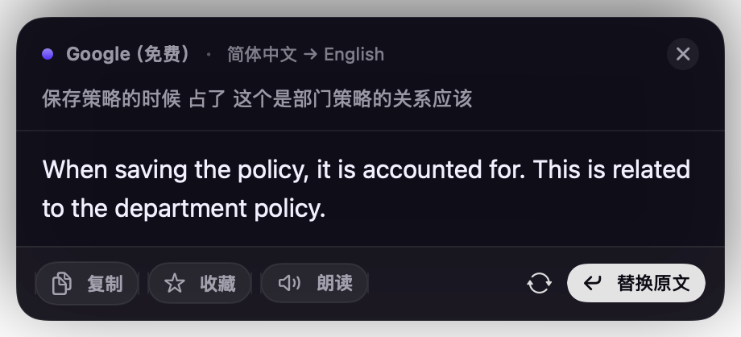
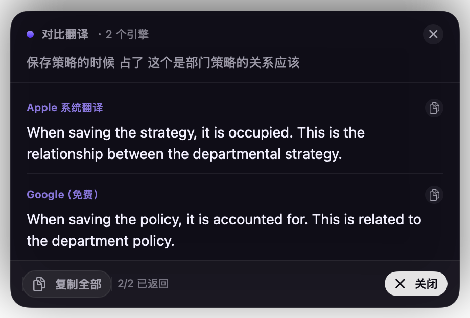

# AirLingo

macOS 菜单栏划词翻译工具，SwiftUI + AppKit 原生实现。

选中任意应用里的文字，按下快捷键，在光标旁弹出译文；支持截图取字翻译、多引擎对比、静默原地替换。



## 功能

| | |
|---|---|
| 主动翻译 | 独立悬浮弹窗，粘贴整段文字，自动判断目标语言，可切换引擎、朗读与收藏 |
| 划词翻译 | 双击修饰键或组合键，读取选区文字并在光标旁浮窗显示译文 |
| 静默替换 | 译文直接写回输入框，不弹窗 |
| 截图翻译 | 框选屏幕区域，Vision 取字后翻译 |
| 对比翻译 | 多个引擎同时翻译，结果并排展示 |
| 朗读 | 系统 TTS 朗读译文 |
| 历史 / 收藏 | 本地 JSON 存储，菜单栏可回看最近翻译 |
| 引擎 | Apple 系统翻译、Google、OpenAI 兼容（DeepSeek/通义/Kimi 等）、DeepL、本地 Ollama |
| 快捷键 | 按键直接录制，带冲突校验 |
| 开机自启 | 系统登录项（`SMAppService`） |



## 系统要求

- macOS 14 或更高
- Apple 系统翻译需要 macOS 15 及已安装对应语言包
- 目前只构建了 Apple Silicon（arm64）

## 安装

从 [Releases](https://github.com/zhf883680/AirLingo/releases) 下载最新的 `AirLingo-*.dmg` 或 `*.zip`，把 `AirLingo.app` 拖进 `/Applications`。

应用没有 Apple 开发者签名与公证，首次打开会被 Gatekeeper 拦下：

```bash
xattr -dr com.apple.quarantine /Applications/AirLingo.app
```

或者右键点应用 → 打开 → 再次确认「打开」。

## 首次使用

需要两个权限，缺一个对应功能就不工作：

1. **辅助功能**（划词、静默替换、全局快捷键）
   `系统设置 › 隐私与安全性 › 辅助功能` 勾选 AirLingo
2. **屏幕录制**（截图翻译）
   `系统设置 › 隐私与安全性 › 屏幕录制` 勾选 AirLingo

授权后**重启应用**生效。设置页「通用」里有「重置授权记录」和「重启应用」两个按钮，权限状态异常时可以先点它们。

> 用 Apple 系统翻译时，如果目标语言的语言包还没装，macOS 会自己弹出「下载语言以翻译」的窗口（这是系统的提示，不是 AirLingo 做的）。点「下载」等它装完即可，也可以点「完成」跳过。装好之后不用重启 AirLingo，下次翻译直接生效。

## 默认快捷键

| 功能 | 默认 |
|---|---|
| 划词翻译 | 双击 `⌃` |
| 静默替换 | 双击 `⌥` |
| 截图翻译 | `⌥ ⌘ O` |
| 对比翻译 | `⌃ T` |

全部可在「快捷键」页点击后重新录制。

## 引擎配置

- **Apple 系统翻译**：系统内置，离线，不需要密钥。首次使用某语种要在「系统设置 › 通用 › 语言与地区 › 翻译语言」里加好语言包。
- **Google（免费）**：内置接口，无需配置。
- **OpenAI 兼容**：填 `接口地址` + `API Key` + `模型`，任何 OpenAI 兼容服务都能接。
- **DeepL**：填 API Key，Free / Pro 都支持。
- **本地 Ollama**：默认 `http://127.0.0.1:11434`，填模型名即可。

API Key 只写在本机 `~/Library/Application Support/AirLingo/config.json`，不会上传到任何地方。

## 从源码构建

需要 Xcode（提供 Swift 工具链）：

```bash
bash scripts/build.sh              # 产出 build/AirLingo.app
AIRLINGO_INSTALL=1 bash scripts/build.sh   # 额外安装到 /Applications
```

没有用 Xcode 工程，`swiftc` 直接编译 `Sources/AirLingo/**/*.swift`，再拼装 `.app`。

### 关于签名

`scripts/build.sh` 会优先用名为 `AirLingo Dev` 的证书签名，找不到就退回 ad-hoc。**建议自签一个**：ad-hoc 签名下系统的 TCC 授权绑定在 cdhash 上，每次重新编译都会变，辅助功能和屏幕录制权限就"开着但无效"。用固定证书签名后，权限不会随构建失效。

自签证书可以这样建（只需一次）：

```bash
openssl req -x509 -newkey rsa:2048 -sha256 -days 3650 -nodes \
  -keyout key.pem -out cert.pem -subj "/CN=AirLingo Dev" \
  -addext "keyUsage=critical,digitalSignature" \
  -addext "extendedKeyUsage=critical,codeSigning" \
  -addext "basicConstraints=critical,CA:false"

openssl pkcs12 -export -inkey key.pem -in cert.pem -out id.p12 -passout pass:airlingo
security import id.p12 -k ~/Library/Keychains/login.keychain-db -P airlingo -T /usr/bin/codesign
security add-trusted-cert -d -r trustRoot -p codeSign -k ~/Library/Keychains/login.keychain-db cert.pem
```

私钥文件不要提交到仓库（已在 `.gitignore` 里排除）。

## 目录结构

```
Sources/AirLingo/
  AirLingoApp.swift        入口、菜单栏、各类命令行自检
  Core/
    AppController.swift    各功能的动作编排
    AccessibilityService.swift  读选区 / 写回 / 权限
    OCRService.swift       框选 + ScreenCaptureKit + Vision
    Translator.swift       各引擎请求
    AppleTranslateService.swift  Apple Translation 框架桥接
    HotkeyCenter.swift     Carbon 热键 + 双击修饰键
    ConfigStore.swift      配置读写
    HistoryStore.swift     历史与收藏
    Speaker.swift          朗读
    StartupService.swift   开机自启
  UI/
    DashboardView.swift    控制台窗口
    Panes.swift            引擎 / 快捷键设置页
    PopupView.swift        划词浮窗
    TranslatePane.swift    主动翻译弹窗（输入 / 译文 / 引擎切换）
    TranslateWindow.swift  主动翻译弹窗的悬浮窗口控制
    HUD.swift              轻提示
    Theme.swift            配色
    HotkeyRecorder.swift   快捷键录制
scripts/
  build.sh                 编译 + 组装
  assemble.py              生成 .app、签名、安装
  make_icon.swift          生成 AppIcon.iconset
  Info.plist
```

## 开发期自检

二进制里带了一些无界面自检入口，方便验证行为：

```bash
AirLingo --snapshot out.png engines 900    # 渲染设置页
AirLingo --popup-live-test /tmp/out        # 真实弹出浮窗 + 真实翻译，输出尺寸/命中测试
AirLingo --translate-snapshot /tmp/out.png # 主动翻译弹窗排版（带示例译文）
AirLingo --translate-popup-test /tmp/out   # 弹窗内粘贴 + ⌘↵ 真实翻译
AirLingo --compare-test /tmp/out           # 对比翻译
AirLingo --ocr-test /tmp/out               # 坐标映射 + 已知文字抓取
AirLingo --ocr-drag-test /tmp/out          # 模拟拖拽框选，走完整截图翻译链路
AirLingo --hotkey-test                     # 快捷键解析
AirLingo --login-test                      # 登录项注册往返
```

## 已知限制

- 只构建了 arm64，Intel Mac 需要自行改 `-target` 重新编译
- 没有句句对齐、AI 语法分析、跟读打分（原版走 Trancy 自家服务）
- 界面固定深色，暂不支持浅色主题与界面缩放
- 没有 Apple 公证，分发需要用户手动放行

## 声明

界面与交互参考 [Trancy Air](https://www.trancy.org/zh-cn/trancy-air) 的独立复刻实现：代码、资源全部重新编写，不包含原版任何二进制、素材或私有接口。仅供个人研究与自用。
